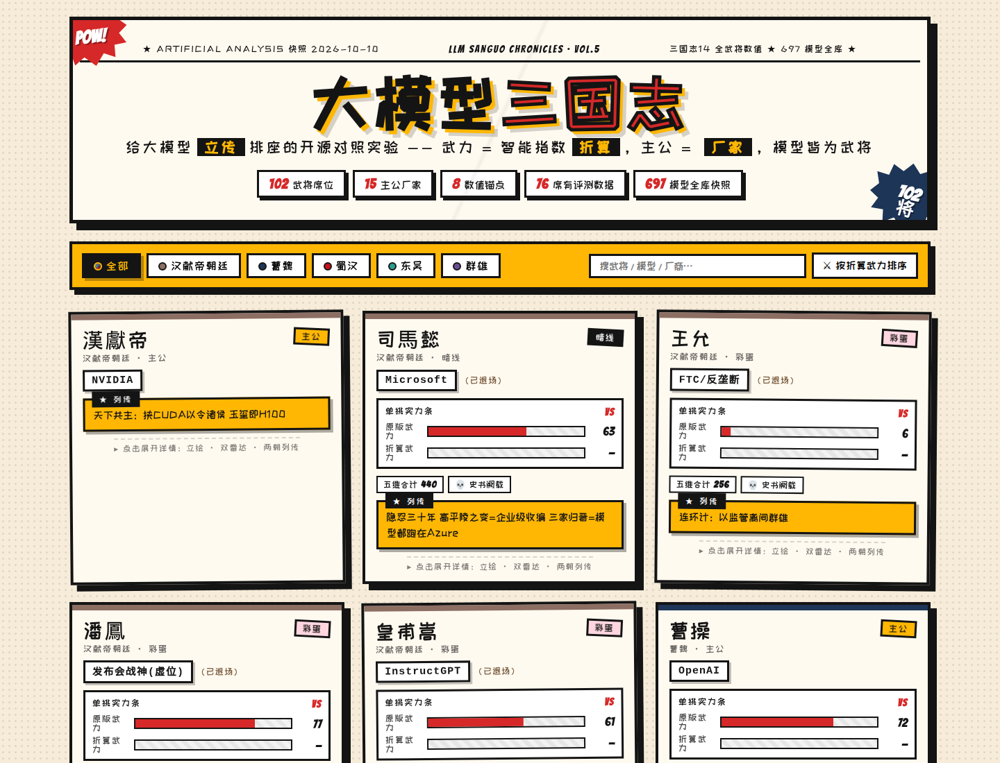
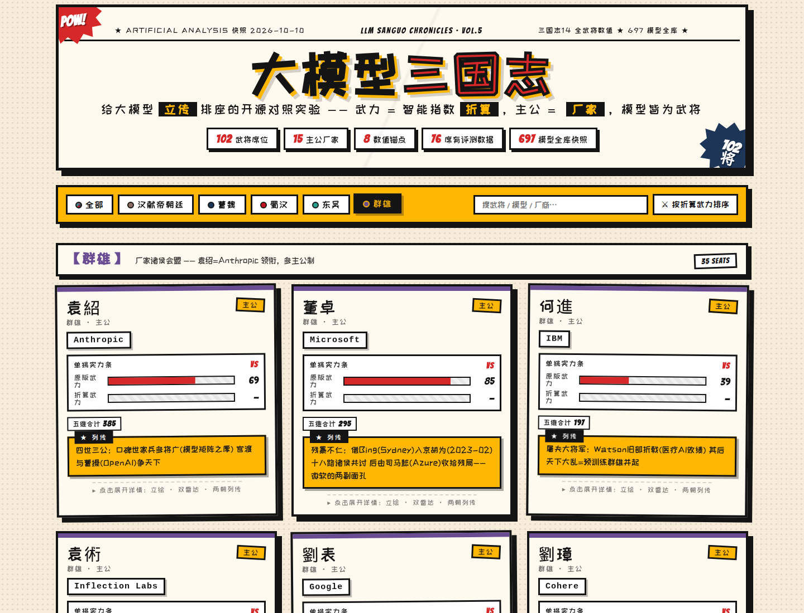
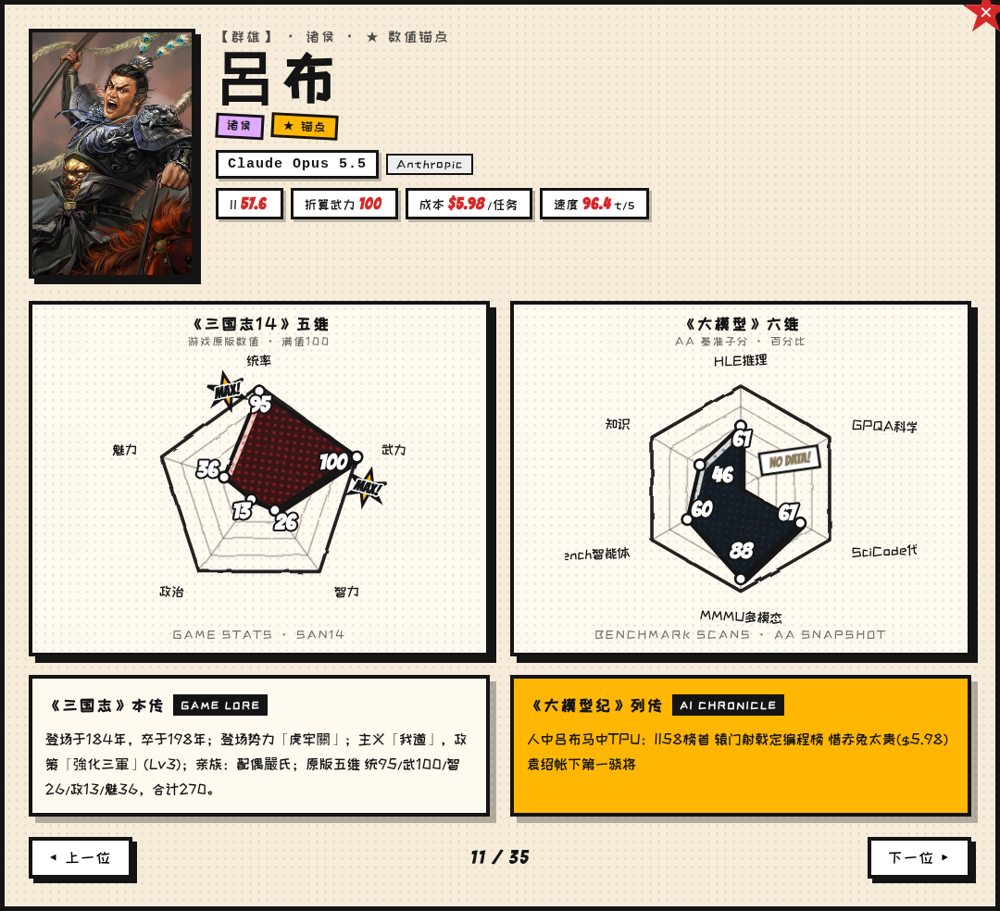
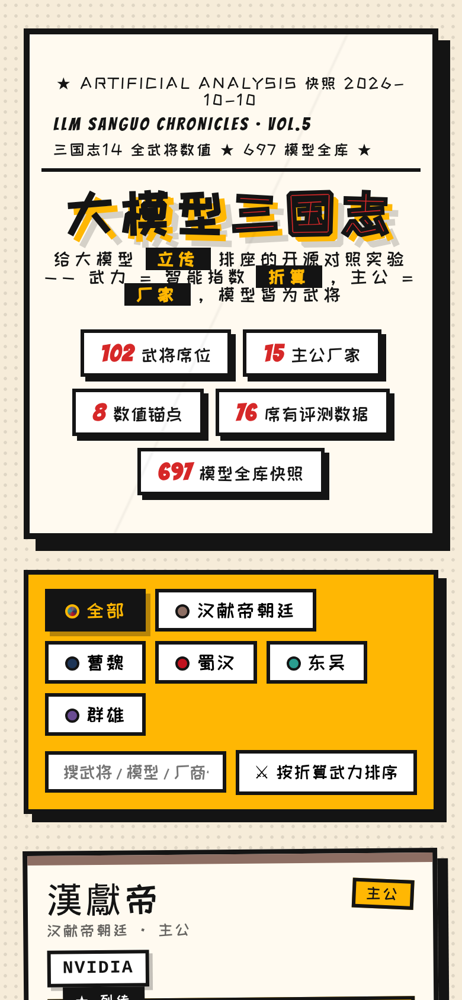
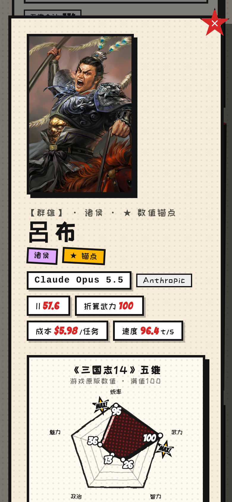
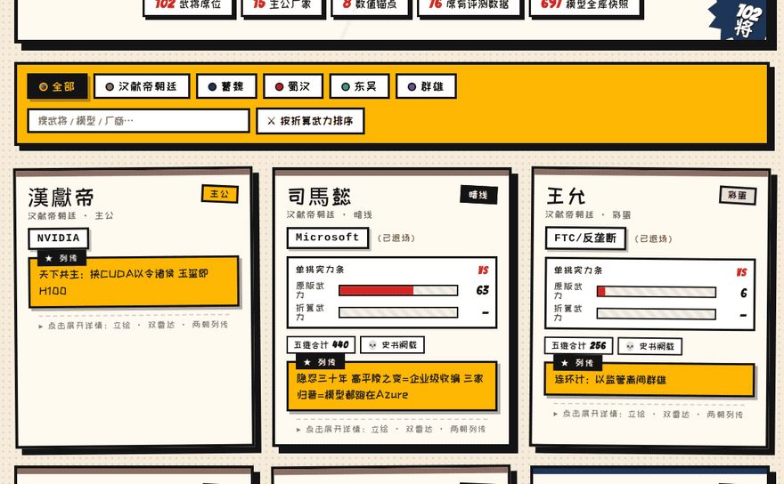

[中文](README.md)

# LLM Sanguo

[](https://illegalcreed.github.io/llm-sanguo/)
[](LICENSE)

**Live site: <https://illegalcreed.github.io/llm-sanguo/>**

> Among men, Lü Bu. Among horses, Red Hare. Among cards, Blackwell.

It seats today's models next to the 1,180 officers of *Romance of the Three Kingdoms XIV* (Power-Up Kit), using the [Artificial Analysis](https://artificialanalysis.ai/leaderboards/models) leaderboard snapshot from 2026-10-10. Warfare tracks the Intelligence Index. Intellect tracks cost efficiency. The ruler's seat is the lab.

The published "romance" edition has **102 seats** on a single comic-style page: faction tabs, search, sort, and a detail view with a portrait (or a surname stand-in), two radar charts, and a short chronicle for each side. The page is static. Open it and read; no API key.

## How a seat is chosen

1. **Warfare ↔ Intelligence Index** (weight 0.7). The snapshot leader is 100: `warfare = round(model II ÷ leader II × 100)`. The leader is Claude Opus 5.5, II **57.6**.
2. **Intellect ↔ cost efficiency** (weight 0.3). A lower cost per task means a higher intellect percentile.
3. Leadership, politics, and charm would track agentic skill, alignment, and usage. Those columns are not in the snapshot yet, so they are filled in by hand.
4. Faction and anecdote only break ties and carry the story. They are not scored. A ruler seat is a company (Cao Cao = OpenAI, Liu Bei = High-Flyer (DeepSeek), Sun Quan = Meta, Yuan Shao = Anthropic). Models sit in officer seats.

The "mandate" edition is an automatic percentile match: `score = 0.7 × |II percentile − warfare percentile| + 0.3 × |cost percentile − intellect percentile|`. Lower is closer. The site shows the hand-arranged romance edition: faction first, still constrained by the formula. The two editions are allowed to disagree.

Eight starred anchors on the site, taken from the current romance table `mapping/mapping_v0.5.csv` (derived warfare : original game warfare):

| Model | Officer | Derived : original |
|---|---|---|
| Claude Opus 5.5 | Lü Bu | 100 : 100 |
| Claude Fable 5.1 | Wen Chou | 93 : 94 |
| GPT-6 Astra | Cao Zhang | 91 : 90 |
| Claude Opus 5 | Gao Shun | 88 : 86 |
| GPT-5.6 Sol | Wen Ping | 82 : 82 |
| Claude Haiku 5.5 | Cao Xing | 75 : 74 |
| GPT-4 | Xun Yu | 12 : 14 |
| Olmo 3.1 32B Think | Gu Yong | 12 : 18 |

GPT-6 Astra's published seat is Cao Zhang (91 against an original 90). `mapping/suggestions_tianming.csv` is an older automatic suggestion from the integer-score table export, where Astra's nearest officer was Yan Liang. That file does not drive the live page.

## The page

Overview:



The coalition tab (Yuan Shao = Anthropic, 35 seats):



Lü Bu / Claude Opus 5.5, with the game pentagon and the benchmark radar:



Mobile width (390px):





Switching factions, then opening Lü Bu:



## Which numbers are current

Scripts and the site read `data/aa_models_snapshot_2026-10-10.csv`: **697 models, 687 of them scored** on the Intelligence Index. `data/aa_models_raw.tsv` is an earlier leaderboard-table export, **267 active rows**, kept as an archive and not used for the current conversion. `data/sanguo14_officers.csv` has 1,180 officers.

## Build it locally

Python 3 and the standard library. No third-party packages.

```bash
# Mandate edition. Rewrites mapping/suggestions_tianming.csv from the current snapshot.
python3 scripts/match.py --model "Claude Opus 5.5"

# Romance table. Run after editing mapping/mapping_source.csv.
python3 scripts/enrich_mapping.py

# Page. mapping/mapping_v0.5.csv → docs/index.html
python3 scripts/build_site.py
```

Open `docs/index.html`, or serve the `docs/` directory. GitHub Pages publishes that directory.

## Layout

```
├── data/
│   ├── sanguo14_officers.csv                 # 1,180 officers, cleaned
│   ├── aa_models_snapshot_2026-10-10.csv     # full snapshot: 697 models / 687 scored
│   ├── aa_models_raw.tsv                     # table export archive: 267 active rows
│   └── *_raw.*
├── docs/
│   ├── index.html                            # the page (generated by build_site.py)
│   ├── methodology.md
│   ├── ROADMAP.md
│   ├── portraits/                            # 82 portraits; the other 20 seats use a surname mark
│   └── assets/                               # screenshots in this README
├── mapping/
│   ├── mapping_source.csv                    # hand-maintained relations and notes
│   ├── mapping_v0.2.csv … mapping_v0.4.csv   # earlier editions
│   ├── mapping_v0.5.csv                      # current romance edition, 102 seats
│   └── suggestions_tianming.csv              # mandate suggestions (older table)
├── scripts/
│   ├── enrich_mapping.py                     # source → v0.5
│   ├── build_site.py                         # v0.5 → docs/index.html
│   ├── rebuild_snapshot.py                   # rebuild the AA snapshot
│   └── match.py                              # automatic mandate match
├── LICENSE                                   # MIT, code only
├── NOTICE                                    # ownership of stats and portraits
└── AGENTS.md
```

Officer names in the data files keep the traditional characters from the game table. Prose uses simplified characters; they are the same people.

## Roadmap

Done: both source tables, the method, romance edition v0.5 (102 seats), the mandate script, and the comic page on GitHub Pages.

Not done yet:

- AA Agentic / Coding indexes, for the leadership stat
- OpenRouter usage share, for charm
- Kept snapshots, so a seat can show a growth curve

See [docs/ROADMAP.md](docs/ROADMAP.md) and [docs/methodology.md](docs/methodology.md).

## Data, portraits, and the license

[LICENSE](LICENSE) is the standard MIT license and **covers the code only** (`scripts/` and the project docs). It does not cover:

- *Romance of the Three Kingdoms XIV* officer stats, or the portraits in `docs/portraits/`. Those are **© KOEI TECMO GAMES**, compiled from [Nobuwiki](https://www.nobuwiki.org/san/game_14/s14_01).
- The evaluation figures, which belong to **Artificial Analysis**.

This is a sourced, non-commercial analogy. It is not affiliated with KOEI TECMO or Artificial Analysis. Rights holders can ask for material to be removed by opening a [GitHub issue](https://github.com/IllegalCreed/llm-sanguo/issues). Details are in [NOTICE](NOTICE).

## Contributing

Issues and pull requests are welcome: swap a seat, add one, fix a number, add a note. One rule: look at the data before you argue the romance.
